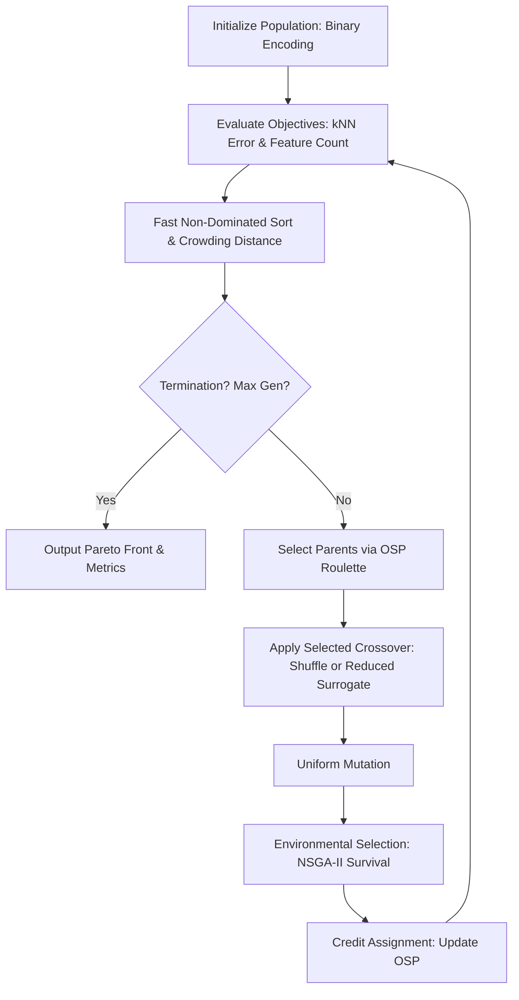

# MOBGA-AOS: Feature Selection via Adaptive Multi-Objective GA

[](https://www.python.org/downloads/)
[](https://opensource.org/licenses/MIT)

An implementation of **MOBGA-AOS** (Multi-Objective Binary Genetic Algorithm with Adaptive Operator Selection) for feature selection in classification.

This project extends NSGA-II by dynamically adapting the selection of crossover operators based on their historical performance, optimizing both classification accuracy and feature reduction.

## 🏗 Architecture & Workflow



## 📊 Performance Metrics

Based on experimental runs across six datasets:

- **Dataset DS02:** IGD = `0.0133 ± 0.0187`, HV = `-1.5148 ± 0.3038`
- **Dataset DS04:** IGD = `0.2650 ± 0.0711`, HV = `13.2825 ± 13.6111`
- **Algorithm Efficiency:** Reduces feature dimensionality while maintaining or improving kNN classification accuracy.
- **Adaptive Mechanism:** OSP successfully biases operator selection toward the most productive crossover operator at different dataset phases.

For more detailed experimental results, see [`BENCHMARKS.md`](BENCHMARKS.md).

## 🚀 Quick Start

### Prerequisites

- Python 3.9+
- `pip` and `virtualenv`
- Dataset files (e.g., `DS02.csv`, `DS04.csv`) placed in the `Datasets/` folder.

### Installation & Execution

#### 1. Clone the Repository

```bash
git clone https://github.com/Rubick666/MOBGA-AOS-Feature-Selection-via-Adaptive-Multi-Objective-GA.git
cd mobga-aos-feature-selection
```

#### 2. Create a Virtual Environment

```bash
python -m venv venv
```

Activate the environment:

**Linux/macOS:**

```bash
source venv/bin/activate
```

**Windows:**

```powershell
venv\Scripts\activate
```

#### 3. Install Dependencies

```bash
pip install -r requirements.txt
```

#### 4. Configure Environment Variables (Optional)

If an example environment file is provided, copy it:

```bash
cp .env.example .env
```

On Windows Command Prompt, you can use:

```cmd
copy .env.example .env
```

#### 5. Run the Experiment

```bash
python src/main.py
```

## 📁 Project Structure

```text
mobga-aos-feature-selection/
├── src/
│   ├── config.py           # Experiment hyperparameters and dataset paths
│   ├── data_utils.py       # Data loading, scaling, and kNN evaluation
│   ├── nsga2_core.py       # Non-dominated sorting and crowding distance
│   ├── operators.py        # Shuffle and Reduced Surrogate crossover
│   ├── metrics.py          # Hypervolume and IGD calculations
│   ├── algorithm.py        # MOBGA-AOS main evolutionary loop
│   └── main.py             # CLI entry point and plotting orchestration
├── Datasets/               # Place your CSV datasets here (git-ignored)
├── results/                # Generated plots (git-ignored)
├── requirements.txt        # Python dependencies
├── BENCHMARKS.md           # Detailed experimental results
└── README.md
```

## 🔐 Security & Configuration

Hyperparameters are managed through environment variables. Create a `.env` file in the root directory and configure the following settings:

```env
DATASET_DIR=Datasets
NUM_RUNS=3
GENERATIONS=50
POP_SIZE=50
MUTATION_RATE=0.01
```

These values configure the dataset directory, number of experimental runs, number of generations, population size, and mutation rate.

## 🔮 Future Improvements

- **Adaptive Mutation:** Implement a mutation operator pool instead of relying exclusively on uniform mutation. Use the same credit assignment mechanism to select mutation strategies dynamically.
- **Local Search:** Integrate a local search step using a memetic algorithm to refine the Pareto front after crossover and mutation.
- **Parallelization:** Evaluate the population concurrently using `joblib` to significantly reduce execution time on large datasets.